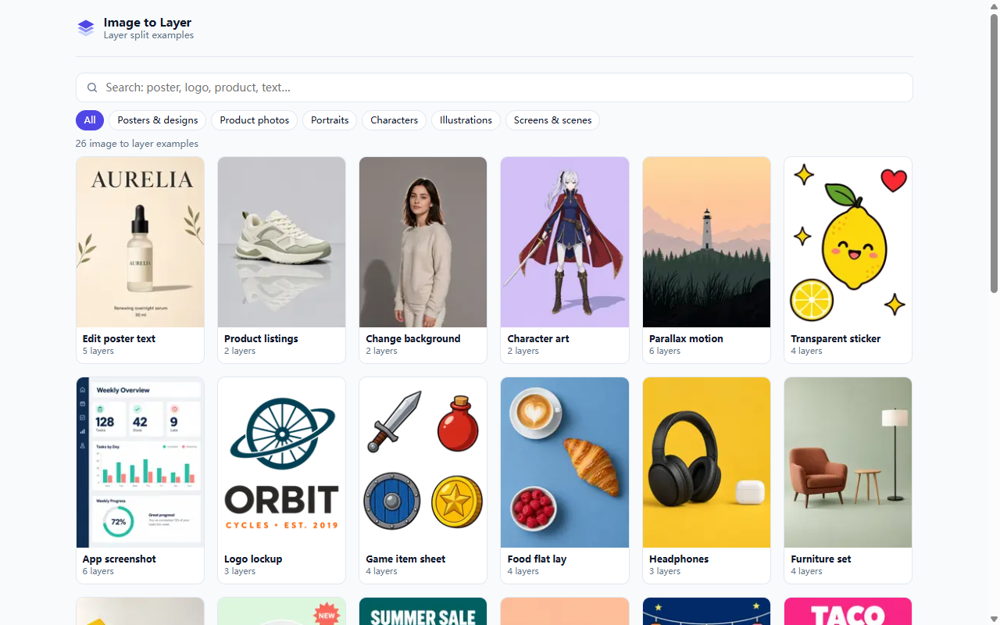
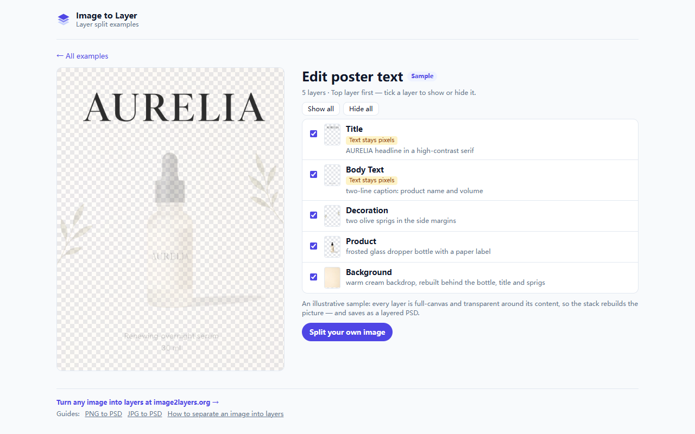

# Image to Layer — Layer Split Examples (Chrome extension)

A small Chrome extension from [Image to Layer](https://image2layers.org/) that lets you browse **26 image to layer examples offline** and see exactly how a flat picture comes apart into editable layers — posters, product photos, logos, app screenshots, illustrations and character art.

## What it does

- **Example library, stored locally** — 26 samples and 110 layers ship inside the extension. Nothing is fetched while you browse.
- **Search and filter** — search by image type or layer (`poster`, `logo`, `product`, `text`, `background` …) in English or Chinese, or filter by category.
- **Layer by layer** — open an example to toggle each layer on and off, or hover a layer to isolate it, just like the Layers panel in Photoshop. Text layers are marked, because text comes back as pixels, not live type.
- **Right-click search** — select any text on a page and choose *Search image to layer examples for “…”*.
- **Right-click on an image** — *Split this image into layers on Image to Layer* opens the tool, where you can split your own image and download a layered PSD.

The examples are illustrative samples prepared for [image2layers.org](https://image2layers.org/); each layer is full-canvas and transparent around its content, so the stack rebuilds the picture and saves as a layered PSD. Related guides:

- [PNG to PSD](https://image2layers.org/png-to-psd) · [JPG to PSD](https://image2layers.org/jpg-to-psd) · [WebP to PSD](https://image2layers.org/webp-to-psd)
- [AI-generated image to PSD](https://image2layers.org/ai-generated-image-to-psd)
- [How to separate an image into layers](https://image2layers.org/guides/how-to-separate-an-image-into-layers)

## Install

- **Chrome Web Store** — [Image to Layer — Layer Split Examples](https://chromewebstore.google.com/detail/oonfapejgpbhchphjdlpkhegelljkfne) (in review; live once approved).
- **From source** — clone this repo, open `chrome://extensions`, turn on *Developer mode*, click *Load unpacked* and pick the folder.

## Privacy

The extension collects no data, sends nothing anywhere and has no analytics. It asks for one permission, `contextMenus`, for the two right-click entries. Links to image2layers.org carry UTM parameters so the site can tell visits came from the extension. See [PRIVACY.md](PRIVACY.md).

## Files

| File | What it is |
|---|---|
| `manifest.json` | Manifest V3; one permission (`contextMenus`) |
| `library.html` / `library.js` / `library.css` | The library — the toolbar popup, and the full-tab view (`?tab=1`) |
| `data.js`, `samples/` | The 26 examples and their layer images |
| `background.js` | The two context-menu entries |
| `_locales/` | English and Simplified Chinese |
| `store-assets/` | Store screenshots and promo tiles (not packaged) |

## License

Code: [MIT](LICENSE). Sample images © Image to Layer, included for use in this extension.

---

**中文简介：** Image to Layer 图片转图层官方示例库插件。离线浏览 26 个拆层示例，逐层显示/隐藏，右键搜索；想拆自己的图，去 [image2layers.org](https://image2layers.org/zh) 上传并下载分层 PSD。
